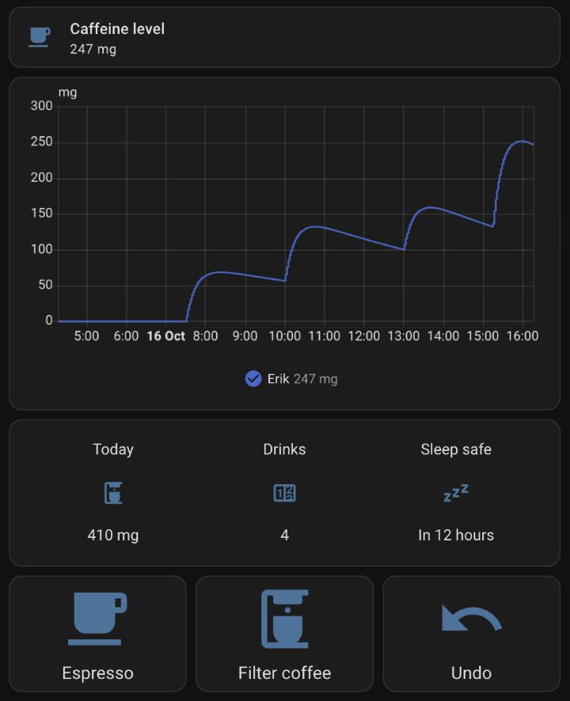
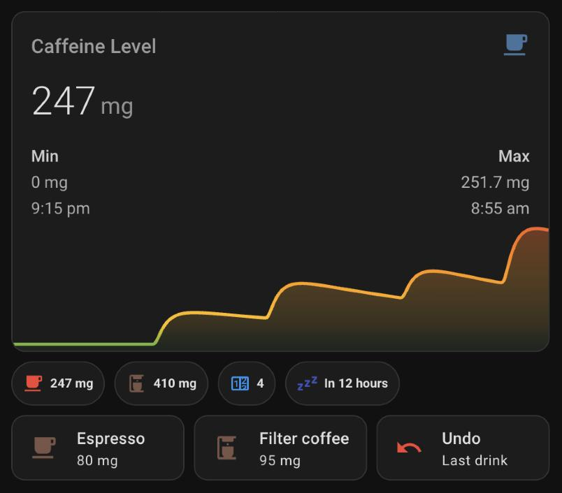

# Lovelace Dashboard

Example cards for a caffeine tracking dashboard. There are two versions:

- [Built-in cards](#built-in-cards): works on any Home Assistant install, nothing extra needed.
- [Mushroom + mini-graph](#mushroom--mini-graph): nicer looking, needs a few cards from HACS.

## Before you start

The examples use a profile named **Erik**. Home Assistant names the entities
after the profile, so replace `erik` with your own profile name:

| Entity | What it shows |
|--------|---------------|
| `sensor.erik_caffeine_level` | Current mg in your body |
| `sensor.erik_caffeine_consumed_today` | Total mg since midnight |
| `sensor.erik_consumptions_today` | Number of drinks since midnight |
| `sensor.erik_sleep_safe_at` | When you drop below your sleep-safe threshold |
| `sensor.erik_estimated_peak_level` | Peak level still to come (only with the absorption model enabled) |

The log buttons target the person's **device**, which logs exactly once per
profile. Find the device ID under **Settings → Devices & Services → Caffeine
Tracker**: open the person's device and copy the last part of the URL. Replace
`YOUR_DEVICE_ID` with it.

---

## Built-in cards

A level tile, a 12-hour history graph, today's totals and log buttons. The Undo
button asks for confirmation first.



```yaml
type: vertical-stack
cards:
  - type: tile
    entity: sensor.erik_caffeine_level
    name: Caffeine level
    icon: mdi:coffee

  - type: history-graph
    hours_to_show: 12
    entities:
      - entity: sensor.erik_caffeine_level
        name: Erik

  - type: glance
    entities:
      - entity: sensor.erik_caffeine_consumed_today
        name: Today
      - entity: sensor.erik_consumptions_today
        name: Drinks
      - entity: sensor.erik_sleep_safe_at
        name: Sleep safe

  - type: grid
    columns: 3
    square: false
    cards:
      - type: button
        name: Espresso
        icon: mdi:coffee
        tap_action:
          action: perform-action
          perform_action: caffeine_tracker.log_consumption
          target:
            device_id: YOUR_DEVICE_ID
          data:
            mg: 80
            label: Espresso

      - type: button
        name: Filter coffee
        icon: mdi:coffee-maker
        tap_action:
          action: perform-action
          perform_action: caffeine_tracker.log_consumption
          target:
            device_id: YOUR_DEVICE_ID
          data:
            mg: 95
            label: Filter coffee

      - type: button
        name: Undo
        icon: mdi:undo
        tap_action:
          action: perform-action
          perform_action: caffeine_tracker.remove_last_consumption
          target:
            device_id: YOUR_DEVICE_ID
          confirmation:
            text: Remove the last drink?
```

For multiple household members, add more entities to the history graph:

```yaml
entities:
  - entity: sensor.erik_caffeine_level
    name: Erik
  - entity: sensor.alex_caffeine_level
    name: Alex
```

---

## Mushroom + mini-graph

Install these from **HACS → Frontend** first:

| Card | What it's used for |
|------|-------------------|
| [mini-graph-card](https://github.com/kalkih/mini-graph-card) | Caffeine decay graph |
| [Mushroom](https://github.com/piitaya/lovelace-mushroom) | Status chips and log buttons |

### Caffeine graph

The decay curve over the last 12 hours. The line shifts from green
(sleep-safe) through amber and orange to red as caffeine builds up.

```yaml
type: custom:mini-graph-card
name: Caffeine Level
icon: mdi:coffee
entities:
  - entity: sensor.erik_caffeine_level
    name: Erik
show:
  fill: fade
  legend: false
  extrema: true
  points: false
color_thresholds:
  - value: 0
    color: "#4CAF50"
  - value: 50
    color: "#FFC107"
  - value: 150
    color: "#FF9800"
  - value: 300
    color: "#F44336"
lower_bound: 0
line_width: 3
height: 120
points_per_hour: 12
hours_to_show: 12
```

### Status chips

Current level (colored by how high it is), today's total, drink count and
sleep-safe time.

```yaml
type: custom:mushroom-chips-card
chips:
  - type: template
    entity: sensor.erik_caffeine_level
    icon: mdi:coffee
    icon_color: >-
      
      greenorangered
    content: "{{ states('sensor.erik_caffeine_level') | float(0) | round(0) }} mg"
    tap_action:
      action: more-info
  - type: entity
    entity: sensor.erik_caffeine_consumed_today
    icon: mdi:coffee-maker
    icon_color: brown
  - type: entity
    entity: sensor.erik_consumptions_today
    icon: mdi:counter
    icon_color: blue
  - type: entity
    entity: sensor.erik_sleep_safe_at
    icon: mdi:sleep
    icon_color: indigo
```

With the absorption model enabled, you can add the peak chip too:

```yaml
  - type: entity
    entity: sensor.erik_estimated_peak_level
    icon: mdi:trending-up
    icon_color: purple
```

### Quick-log buttons

A 3-column grid. Tap a drink to log it; Undo asks for confirmation first.

```yaml
type: grid
columns: 3
square: false
cards:
  - type: custom:mushroom-template-card
    primary: Espresso
    secondary: 80 mg
    icon: mdi:coffee
    icon_color: brown
    tap_action:
      action: perform-action
      perform_action: caffeine_tracker.log_consumption
      target:
        device_id: YOUR_DEVICE_ID
      data:
        mg: 80
        label: Espresso

  - type: custom:mushroom-template-card
    primary: Filter coffee
    secondary: 95 mg
    icon: mdi:coffee-maker
    icon_color: brown
    tap_action:
      action: perform-action
      perform_action: caffeine_tracker.log_consumption
      target:
        device_id: YOUR_DEVICE_ID
      data:
        mg: 95
        label: Filter coffee

  - type: custom:mushroom-template-card
    primary: Cappuccino
    secondary: 80 mg
    icon: mdi:coffee
    icon_color: amber
    tap_action:
      action: perform-action
      perform_action: caffeine_tracker.log_consumption
      target:
        device_id: YOUR_DEVICE_ID
      data:
        mg: 80
        label: Cappuccino

  - type: custom:mushroom-template-card
    primary: Cold brew
    secondary: 155 mg
    icon: mdi:cup
    icon_color: deep-orange
    tap_action:
      action: perform-action
      perform_action: caffeine_tracker.log_consumption
      target:
        device_id: YOUR_DEVICE_ID
      data:
        mg: 155
        label: Cold brew

  - type: custom:mushroom-template-card
    primary: Energy drink
    secondary: 160 mg
    icon: mdi:lightning-bolt
    icon_color: yellow
    tap_action:
      action: perform-action
      perform_action: caffeine_tracker.log_consumption
      target:
        device_id: YOUR_DEVICE_ID
      data:
        mg: 160
        label: Energy drink

  - type: custom:mushroom-template-card
    primary: Undo
    secondary: Last drink
    icon: mdi:undo
    icon_color: red
    tap_action:
      action: perform-action
      perform_action: caffeine_tracker.remove_last_consumption
      target:
        device_id: YOUR_DEVICE_ID
      confirmation:
        text: Remove the last drink?
```

### Full stack

The graph, chips and buttons above in one card you can drop onto any view.



```yaml
type: vertical-stack
cards:
  - type: custom:mini-graph-card
    name: Caffeine Level
    icon: mdi:coffee
    entities:
      - entity: sensor.erik_caffeine_level
        name: Erik
    show:
      fill: fade
      legend: false
      extrema: true
      points: false
    color_thresholds:
      - value: 0
        color: "#4CAF50"
      - value: 50
        color: "#FFC107"
      - value: 150
        color: "#FF9800"
      - value: 300
        color: "#F44336"
    lower_bound: 0
    line_width: 3
    height: 120
    points_per_hour: 12
    hours_to_show: 12

  - type: custom:mushroom-chips-card
    chips:
      - type: template
        entity: sensor.erik_caffeine_level
        icon: mdi:coffee
        icon_color: >-
          
          greenorangered
        content: "{{ states('sensor.erik_caffeine_level') | float(0) | round(0) }} mg"
        tap_action:
          action: more-info
      - type: entity
        entity: sensor.erik_caffeine_consumed_today
        icon: mdi:coffee-maker
        icon_color: brown
      - type: entity
        entity: sensor.erik_consumptions_today
        icon: mdi:counter
        icon_color: blue
      - type: entity
        entity: sensor.erik_sleep_safe_at
        icon: mdi:sleep
        icon_color: indigo

  - type: grid
    columns: 3
    square: false
    cards:
      - type: custom:mushroom-template-card
        primary: Espresso
        secondary: 80 mg
        icon: mdi:coffee
        icon_color: brown
        tap_action:
          action: perform-action
          perform_action: caffeine_tracker.log_consumption
          target:
            device_id: YOUR_DEVICE_ID
          data:
            mg: 80
            label: Espresso

      - type: custom:mushroom-template-card
        primary: Filter coffee
        secondary: 95 mg
        icon: mdi:coffee-maker
        icon_color: brown
        tap_action:
          action: perform-action
          perform_action: caffeine_tracker.log_consumption
          target:
            device_id: YOUR_DEVICE_ID
          data:
            mg: 95
            label: Filter coffee

      - type: custom:mushroom-template-card
        primary: Undo
        secondary: Last drink
        icon: mdi:undo
        icon_color: red
        tap_action:
          action: perform-action
          perform_action: caffeine_tracker.remove_last_consumption
          target:
            device_id: YOUR_DEVICE_ID
          confirmation:
            text: Remove the last drink?
```
